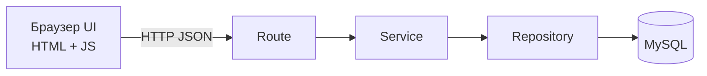

# Архитектур (L11)

| Давхарга | Хариуцлага | Хийхгүй зүйл |
|----------|------------|--------------|
| UI (браузер) | Харуулах, form-ын анхан шалгалт, loading/error төлөв | Бизнес дүрэм шийдэх (хэрэглэгч тойрч чадна) |
| Route | HTTP оролтыг унших, status код, JSON буцаах | SQL бичих, дүрэм шийдэх |
| Service | **Бизнес дүрэм**: SKU давхар эсэх, үлдэгдэл хүрэх эсэх, давхар батлалт, transaction эхлүүлэх | HTTP, req/res мэдэх |
| Repository | SQL query (параметртэй), өгөгдөл унших, бичих | Дүрэм шийдэх |
| MySQL | FK, UNIQUE, CHECK: сүүлчийн хамгаалалт | — |

## Жишээ урсгал: POST /documents/2/post
1. **Route** нь id-г уншаад service-ийг дуудна.
2. **Service** нь transaction эхлүүлж, баримтыг уншина. posted бол 409 ALREADY_POSTED. Мөр бүрийн үлдэгдлийг шалгаад хүрэлцэхгүй бол 409 INSUFFICIENT_STOCK.
3. **Repository** нь status-ыг шинэчилж, movement оруулж, balance-ийг шинэчилнэ.
4. Бүгд амжилттай бол commit, алдаа гарвал rollback хийнэ.
5. **Route** нь 200 эсвэл алдааны JSON буцаана.

## Яагаад дүрэм service-д байх вэ?
UI-гаас гадна Postman, тест, өөр UI-аас ч хүсэлт ирж болно. Дүрэм service-д байвал бүгдэд ижил үйлчилнэ. Мөн Node ба FastAPI хоёр backend ижил бүтэцтэй болно.
