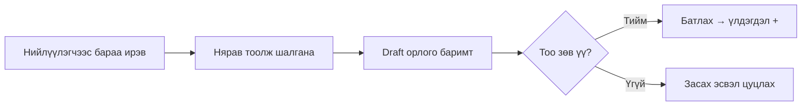
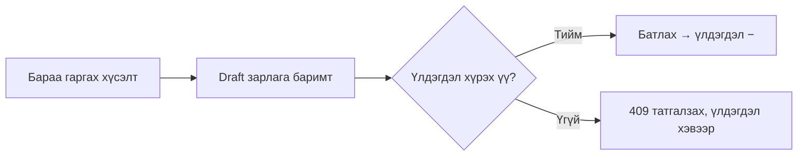
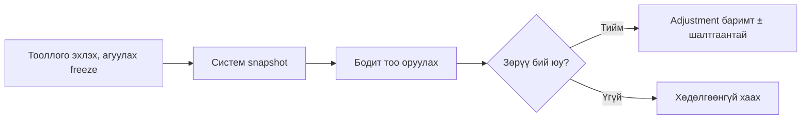

# L03: Асуудал, оролцогч ба процесс

## Оролцогчид
| Дүр | Юу хийдэг | Гол зовлон |
|-----|-----------|------------|
| Нярав | Орлого, зарлага бүртгэж, тооллого хийнэ | Цаасан бүртгэл алдагдаж, үлдэгдэл зөрдөг |
| Менежер | Үлдэгдэл, хөдөлгөөний тайлан хардаг | Бодит үлдэгдлийг шуурхай мэдэхгүй |
| Админ | Хэрэглэгч, эрх, лавлах удирдана | Хэн юу өөрчилснийг мэдэх боломжгүй |

## Асуудлууд
| ID | Асуудал | Хэнд | Хэмжүүр (шалгах нөхцөл) |
|----|---------|------|--------------------------|
| PR-01 | Ижил барааг өөр SKU-гаар давхар бүртгэдэг | Нярав | Байгаа SKU-гаар бараа үүсгэхэд 409, шинэ бараа үүсэхгүй |
| PR-02 | Үлдэгдэл хүрэхгүй байхад зарлагадсан | Нярав | Үлдэгдлээс их зарлага 409, үлдэгдэл хэвээр |
| PR-03 | Батлагдсан баримтыг шууд засаж түүх алдагддаг | Менежер | Posted баримтыг засах/устгах боломжгүй, зөвхөн буцаалтаар |
| PR-04 | Нэг баримтыг хоёр удаа батлаад үлдэгдэл давхар нэмэгдсэн | Нярав | Хоёр дахь батлалт 409, нөлөө нэг удаа |
| PR-05 | Тооллогын зөрүүг тайлбаргүй засдаг | Менежер | Зөрүү adjustment баримтаар, шалтгаантай бүртгэгдэнэ |
| PR-06 | Хэн, хэзээ өөрчилснийг мэдэхгүй | Админ | Үйлдэл бүрд actor, цаг, баримт, шалтгаан хадгалагдана |

## Одоогийн процесс

### Орлого

### Зарлага

### Тооллого

**Оролт:** нийлүүлэгчийн баримт, гаргах хүсэлт, бодит тоо.
**Гаралт:** баримт, хөдөлгөөний журнал, үлдэгдэл, аудит.
