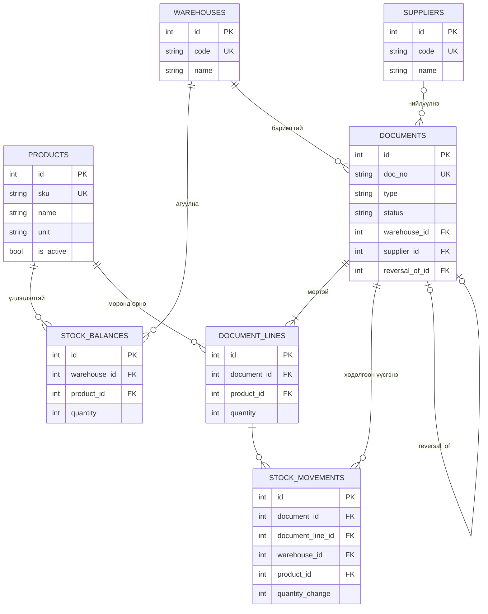

# ERD (L09–L10)

Хүснэгтийн дэлгэрэнгүйг `data-dictionary.md`-ээс үзнэ.

## Хүлээн авах шалгуур (L09)
- Нэг SKU хоёр агуулахад байж болно: P01 нь A-д нэг мөр, B-д нэг мөр.
- Нэг агуулах-барааны balance давхардахгүй: UNIQUE (warehouse_id, product_id).
