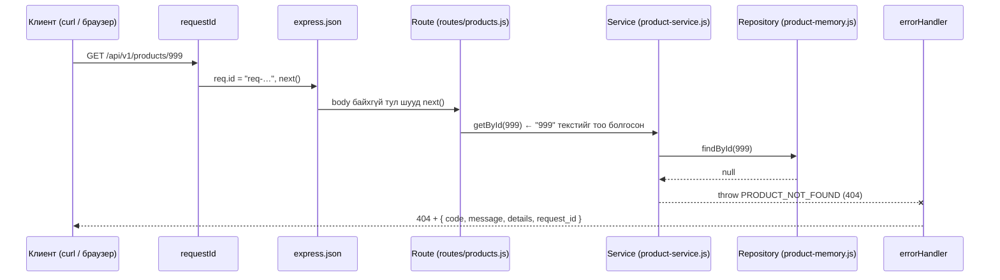

# HTTP хүсэлтийн дамжих дараалал (L18)

Хавтас: `backend/`. Express 5.3 (`package-lock.json`-д түгжсэн).

| Команд (`backend/` дотор) | Юу хийх |
|---------------------------|---------|
| `npm install` | `package-lock.json`-ийн дагуу Express суулгана (`node_modules/` commit хийгдэхгүй) |
| `npm start` | Серверийг `http://localhost:3000` дээр асаана (`PORT=8080 npm start` гэж сольж болно) |
| `npm test` | 39 тест: L17-ийн 23 + L18-ийн HTTP 16 |

## 1. Нэг хүсэлт хаагуур дамжих вэ
Жишээ: `GET /api/v1/products/999`

## 2. Файл бүрийн үүрэг
| Файл | Давхарга | Хийдэг | Хийдэггүй |
|------|----------|--------|-----------|
| `src/index.js` | Эхлэл | Тохиргоо уншиж `listen` дуудна | Route тодорхойлохгүй |
| `src/app.js` | Угсралт | Middleware, route-ийг **дарааллаар** нь холбоно | Сервер асаахгүй (тест өөрөө асаана) |
| `src/middleware/request-id.js` | Middleware | Хүсэлтэд дугаар өгнө | |
| `src/routes/products.js` | Route | `params`, `query`, `body` уншина; status + JSON буцаана | Дүрэм шийдэхгүй |
| `src/services/product-service.js` | Service | 404, 409, 422-ийн аль нь болохыг шийднэ | `req`/`res` мэдэхгүй |
| `src/repositories/product-memory.js` | Repository | Өгөгдөл хайна, нэмнэ (түр санах ой) | Дүрэм шийдэхгүй |
| `src/errors.js` | Нийтлэг | `AppError`: status + code + message + details | |
| `src/middleware/error-handler.js` | Middleware | Бүх алдааг **нэг хэлбэрийн** JSON болгоно | |

## 3. Middleware-ийн дараалал яагаад чухал вэ
`app.js`-д бүртгэсэн дарааллаар хүсэлт дамжина.

| # | Middleware | Байрыг нь сольвол юу болох вэ |
|---|------------|-------------------------------|
| 1 | `requestId` | Доор байвал JSON parse-ийн алдаанд `request_id` байхгүй болно |
| 2 | `express.json()` | Route-ийн дараа байвал `req.body` нь `undefined` |
| 3 | Route-ууд | |
| 4 | `routeNotFound` | Route-ийн өмнө байвал **бүх** хүсэлт 404 болно |
| 5 | `errorHandler` | Хамгийн сүүлд байх ёстой. Үгүй бол Express өөрийн HTML алдааны хуудсыг буцаана |

Middleware бүр `next()` дуудаж дараагийнх руу дамжуулна. Мартвал хүсэлт гацаж, клиент хариу хүлээсээр үлдэнэ.

## 4. Оролтын гурван эх үүсвэр
| Хаанаас | Жишээ | Express-д | Утга | Буруу бол |
|---------|-------|-----------|------|-----------|
| Route parameter | `/products/7` | `req.params.id` | "Аль нэгийг нь" | `abc` → 422 |
| Query | `/products?q=дэв&active=true` | `req.query.q` | "Яаж шүүх вэ" | `active=yes` → 422 |
| JSON body | `POST` + `{"sku":"P06",…}` | `req.body` | "Юу үүсгэх вэ" | хоосон нэр → 422 |

Гурвуулаа сүлжээгээр **текст** хэлбэрээр ирдэг. `"7"`-г `Number` болгохоос өмнө `^[1-9][0-9]*$` regex-ээр шалгасан. Шалтгаан: `Number("")` нь `0`, `Number("1e3")` нь `1000` болдог тул `Number` дангаараа хангалтгүй (L12-ын coercion).

## 5. Хүлээн авах шалгуур: 3 request (бодит гаралт)
`PORT=3456 npm start` асаагаад `curl -i`-ээр авсан.

| # | Хүсэлт | Гэрээ (api-contract) | Гарсан | ✓ |
|---|--------|----------------------|--------|---|
| 1 | `GET /api/v1/products/1` | 200, нэг бараа | `200` `{"id":1,"sku":"P01","name":"Дэвтэр","unit":"ширхэг","is_active":true}` | ✓ |
| 2 | `GET /api/v1/products/abc` | 422 (оролт өөрөө буруу) | `422` `{"code":"VALIDATION_ERROR","message":"Оролт буруу байна","details":{"id":"эерэг бүхэл тоо байх ёстой"},"request_id":"req-a823…"}` | ✓ |
| 3 | `GET /api/v1/products/999` | 404 PRODUCT_NOT_FOUND (P04) | `404` `{"code":"PRODUCT_NOT_FOUND","message":"999 id-тай бараа олдсонгүй","details":{},"request_id":"req-760a…"}` | ✓ |

Гурвууланд нь `X-Request-Id` header байсан бөгөөд алдааны body-ийн `request_id`-тай ижил.

**422 ба 404-ийн ялгаа:** `abc` нь хэзээ ч зөв id болж чадахгүй, DB-г харалгүйгээр мэднэ → 422. `999` нь зөв хэлбэртэй ч одоо тийм бараа байхгүй → 404.

## 6. Бусад шалгалт
| Хүсэлт | Гарсан |
|--------|--------|
| `GET /health` | 200 `{"status":"ok","uptime_s":1}` |
| `GET /products?q=үз` | 200, зөвхөн P02 Үзэг |
| `GET /products?q=zzz` | 200 `[]` (404 биш) |
| `POST /products` `{"sku":"p06","name":"Харандаа"}` | 201, `id: 6`, `sku: "P06"` |
| `POST /products` давхар `P01` | 409 SKU_DUPLICATE |
| `POST /products` эвдэрхий JSON | 400 INVALID_JSON |
| `GET /nope` | 404 ROUTE_NOT_FOUND (JSON) |

## 7. Шийдвэр ба шалтгаан
1. **`app.js` ба `index.js`-ийг салгасан.** Тест `createApp().listen(0)` гэж сул port дээр асаадаг тул 3000 завгүй байсан ч ажиллана.
2. **Repository-ийн функцууд `async`.** Одоо шууд хариулдаг ч L19-д MySQL-ээр солиход service, route өөрчлөгдөхгүй.
3. **Route-д `try/catch` байхгүй.** Express 5 нь `async` handler-ийн алдааг өөрөө error handler руу дамжуулдаг. Express 4-ийн жишээнд `next(err)` гараар дууддаг: хоёр хувилбарын жишээг холихгүй.
4. **500 алдааны дэлгэрэнгүйг клиентэд өгөхгүй.** Stack trace серверийн log-д `request_id`-тай хамт бичигдэнэ.
5. **Гэрээнд нэмсэн:** `400 INVALID_JSON`, `404 ROUTE_NOT_FOUND`, `GET /health`, `?q=`, `?active=` (api-contract.md-д тусгав).

## 8. Мэдэгдэж буй хязгаар
- Өгөгдөл санах ойд байгаа тул **restart хийхэд нэмсэн бараа алга болно**. L19-д MySQL-ээр шийднэ.
- SKU давхардлыг `findBySku` → `insert` гэж хоёр алхмаар шалгаж байна. Зэрэг ирсэн хоёр хүсэлт хоёулаа өнгөрч болно. L20-д DB-ийн UNIQUE constraint-ээр хамгаална.

## 9. Дараагийн алхам (L19)
- Сургалтын DB, хязгаарлагдмал хэрэглэгч, `001_...sql` migration
- `mysql2` pool-ийг тусдаа module-д нэг удаа үүсгэнэ (node-runtime.md §3: `require` cache)
- `repositories/product-mysql.js` нь `product-memory.js`-тэй ижил 4 функцтэй, параметрт query-тэй
