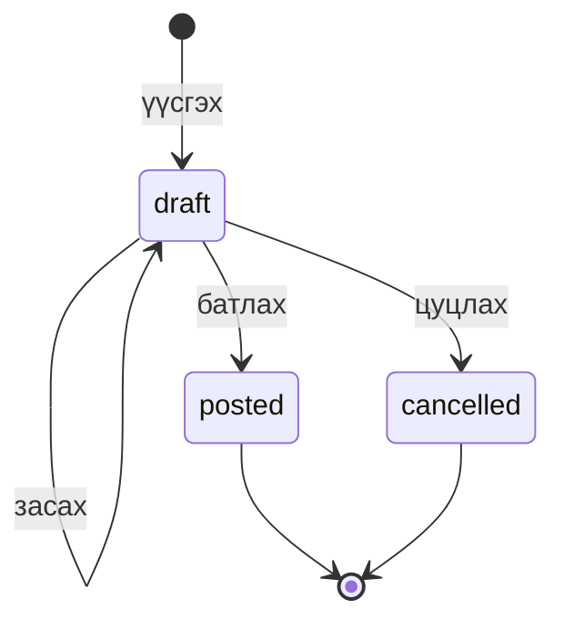

# Баримтын төлвийн дүрэм (L10)

| Төлөв | Засах | Устгах | Үлдэгдэлд нөлөөлөх | Алдаатай бол |
|-------|-------|--------|--------------------|---------------|
| draft | Болно | Болно | Үгүй | Шууд засна |
| posted | 409 | 409 | Тийм (stock_movements) | Буцаах (reversal) баримт үүсгэнэ |
| cancelled | 409 | 409 | Үгүй | — |

## Дүрмүүд
1. **Draft нь үлдэгдэлд нөлөөлөхгүй.** Movement үүсэхгүй (AC-04.1, P06).
2. **Батлах үед** status → posted, мөр бүрт movement, stock_balances шинэчлэх гурвыг **нэг transaction**-д хийнэ. Аль нэг нь бүтэлгүйтвэл бүгд буцна (T04).
3. **Давхар батлалт** нь 409 буцаана, нөлөө нэг удаа л гарна (AC-06.2, P11, T05).
4. **Зарлага хүрэлцэхгүй бол** баримт бүхэлдээ татгалзагдана (409), үлдэгдэл хэвээр (AC-05.3, P10).
5. **Posted баримтыг засахгүй.** Алдааг бүтэн reversal баримтаар залруулна: reversal_of_id нь эх баримтыг заана, UNIQUE учраас хоёр дахь reversal 409 (AC-07.2, T07).
6. **Нэг баримтад ижил бараа хоёр мөр байхгүй**: UNIQUE (document_id, product_id). P01-ийг 3 ба 2 гэж хоёр мөрөнд бичвэл нийлүүлэх үү, аль нь зөв бэ гэдэг нь тодорхойгүй болно. Тоог нэг мөрөнд нэгтгэнэ.

## Урсгалын жишээ (T03: A агуулах, P01)
| Алхам | documents | stock_movements | stock_balances |
|-------|-----------|-----------------|----------------|
| Opening 10 батлах | #1 opening, posted | +10 | 10 |
| Receipt 5 draft | #2 receipt, draft | — | 10 |
| Receipt батлах | #2 → posted | +5 | 15 |
| Issue 4 батлах | #3 issue, posted | −4 | 11 |
| Issue-г буцаах | #4 reversal, reversal_of_id = 3 | +4 | 15 |
| #3-ыг дахин буцаах | — | — | 409, 15 хэвээр |
